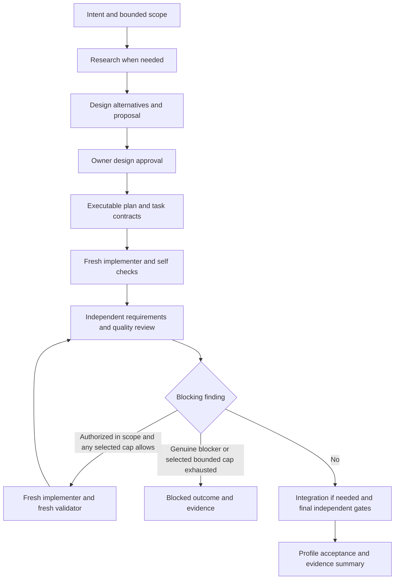

# Shared orchestration workflow design for Superpowers and OpenCode Harness

Date: October 31, 2026  
Status: Running design for review  
Audience: Harness maintainers and engineers planning the refactor

Combine Superpowers' development practices with OpenCode Harness's typed delegation and independent acceptance. Add a shared workflow layer that helps agents clarify intent, design, plan, implement, investigate failures, and review results. Reduce avoidable stalls through accurate preflight, minimal task graphs, proportionate review, and actionable recovery. Keep execution authority in the existing harness protocols and preserve the distinct source, portable, external runtime, and global-native boundaries.

The owner selected a shared workflow across all harness profiles and subsequently authorized the first implementation increment through a Codex direct bootstrap exception. Work proceeds on a new branch after checkpoint `6e264eb` was committed and pushed. The [implementation plan](../plans/2026-10-31-shared-development-workflow.md) covers shared guidance, validated contract examples, and profile packaging. Installation, activation, and the conditional runtime changes below remain outside this increment.

## Purpose and success criteria

Superpowers makes development work explicit: agree on the design, write actionable tasks, give workers bounded context, test behavior, and review both requirements and quality. The harness makes delegation explicit: admit a bounded specification, correlate native children, enforce role contracts and budgets, and require independent evidence before acceptance. The refactor should connect these strengths without making a workflow prompt a second source of execution authority.

Success means that an approved change can move through one understandable workflow on every supported profile, while unsupported capabilities produce an explicit blocker. Workers receive only their requirements, relevant interfaces, constraints, and evidence references. Review checks requirements and quality without duplicating dispatches. Runtime rejection, stale evidence, exhausted budgets, and uncertain cancellation remain failures even when a progress ledger looks complete.

The expected benefits are less repeated context, fewer speculative fixes, fewer avoidable refusals, and clearer handoffs. These are hypotheses to evaluate, not measured improvements. An unnecessary block means authorized, in-scope work cannot advance because of avoidable planning, presentation, scheduling, or environment mismatch. Missing authorization, failed acceptance, uncertain worker termination, and invalid native identity remain legitimate blockers.

## Current foundations

| Foundation | Existing strength | Refactor implication |
| --- | --- | --- |
| Superpowers brainstorming and planning | Alternatives, design approval, small tasks, explicit interfaces, constraints, and verification | Adapt the workflow into harness-owned guidance and bounded role packets |
| Superpowers subagent development | Fresh initial workers, focused briefs, task review, final broad review, durable progress records | Retain context discipline and review coverage; replace conflicting continuation and acceptance rules |
| Superpowers debugging and verification | Investigate causes, reproduce failures, test behavior, require evidence before claims | Make these practices part of scoped implementation and validation |
| Harness role contracts | Exactly four roles with explicit modes and structured results | Express every specialty through the existing roles |
| Harness controller and profile adapters | DAG readiness, budgets, native identity, evidence binding, profile-specific cancellation | Keep these components authoritative |
| Harness interactive refinement | Finite owner test rounds and separate automation and manual verdicts | Reuse its agreement and manual test records rather than introduce another refinement loop |

The original comparison used installed Superpowers 7.0.1 skills and harness revision `fce2460b72f8ef1c44bd740534d638f100189a65`. The October 31 blocking analysis also inspected the then-uncommitted source, generated artifacts, instructions, and tests, subsequently recorded in checkpoint `6e264eb`. This checkout evidence does not establish an installed release or live provider behavior. Installed skill behavior matters: its fix loop resumes original implementers during early rounds and permits parking findings at a cap; those rules conflict with managed harness task freshness and acceptance.

## Current causes of avoidable blocking

### Changes already present in the working tree

The controller now accepts `budgets: {"mode":"unbounded"}` and empty budgets without workflow total-agent, per-role, or remediation caps. Numeric specifications remain bounded for compatibility. Instructions and primary-session context now select managed delegation automatically for substantive coding, with simple questions and trivial low-risk edits eligible for direct handling. The controller already permits implementation followed directly by independent validation, without a ceremonial integration task.

These address older sources of friction and supersede this design's original explicit-invocation and mandatory finite-budget defaults. Preserve them in the shared projection. Unbounded workflow budgets still retain deadlines, scope, fresh identities, capacity, resource limits, and acceptance checks. Interactive owner refinement may retain its separately agreed finite rounds; it must not silently recast the controller's unbounded default as a finite workflow budget.

### Remaining mechanisms and remedies

The conditions below are established by source inspection and focused offline fixtures. Their frequency and cost in actual user sessions have not been measured. Each remedy targets the avoidable part of the condition, while retaining the underlying authority or evidence check.

| ID | Current mechanism and avoidable consequence | Remedy through the refactor |
| --- | --- | --- |
| B1 | `reserve` requires every earlier declared role/mode to succeed. An overplanned work unit can wait on research, synthesis, or integration that adds no new deliverable. Scope expansion is rejected even if a parent set an approval flag. | Derive the smallest task graph that meets the goal. Add research or integration only for an actual evidence gap or combined deliverable. Surface genuinely changed scope as a fresh specification; do not tell the owner that approval alone can mutate an admitted run. |
| B2 | Successful validator results must prove assigned unit gates regardless of validator mode. A `review` of requirements can therefore inherit the full acceptance command burden when placed in a unit with those gates. Every work unit currently requires nonempty gate assignments. | Combine review and final command checks in one independent validator task when that covers the deliverable. If a separate review unit is useful, give it a meaningful compatible command-backed gate; it cannot be gate-free today. A later executable change may make gate obligations explicit per validator mapping, with versioned validation and no path to accept an unclosed gate. |
| B3 | Starting an implementer clears controller gates and completed validator mappings; legacy dispatch also clears accepted proof. A serial sequence of per-task acceptance, another edit, and acceptance again repeats checks by construction. | Review intermediate diffs for defects, then group writes that belong to one deliverable before its final acceptance. Preserve any gate needed to authorize downstream work. Keep conservative invalidation until complete command-input dependencies can be proven; path-disjoint edits alone cannot justify reusing old proof. |
| B4 | The legacy shell allows only exact predeclared commands, runs read-only with isolated `/tmp`, masks ignored inputs, and rejects incompatible source/package QA. An ordinary test or build can be impossible in that environment. | Preflight command/environment compatibility before freezing gates. Choose compatible read-only gates plus separately recorded external QA when available, or report the missing verification route before implementation. Global native permissions may support the same check, but changing profiles requires an explicit choice. Never label external QA a legacy managed gate. |
| B5 | The controller defaults each task to five minutes, including clarification time, independent of unbounded workflow budgets. Expiration reserves capacity until termination is reconciled. | Size tasks and expose the actual deadline in the brief. Propose adapter-supported deadline selection before admission for predictable long work; do not extend a running expired task or treat status chatter as renewed authority. Until implemented, split only where outputs are independently meaningful. |
| B6 | Legacy result/proof verification can call `interrupt`, stopping all registered controllers. Missing gate command success or invalid artifact proof can enter the same recovery path as uncertain workspace effects. | Prevent common proof errors with generated result examples and preflight. A later runtime change should distinguish a proven, safely terminated local task failure from unknown effects. Only the former may permit a fresh scoped retry without a process-wide stop. Retain current stop/release rules until that distinction is enforced and tested. |
| B7 | Exact packet fields, nonempty prose/list requirements, result field names, evidence pairing, and trace paths create many opportunities for a useful answer to be rejected for format. | Render briefs and result templates from executable contracts, include concrete valid examples, and check local shape before child dispatch or terminal submission where the host supports it. Preserve strict identity, evidence, and size limits. A template or shape check grants neither admission nor acceptance. |
| B8 | Automatic delegation selects a workflow that may have unavailable tools or a profile collision. Global collision detection conservatively uses project harness file presence, rather than proving both plugins are active. | Establish one active profile and actual callable capabilities at preflight, and give exact supported migration/bootstrap instructions. Never ask the owner to relay internal JSON or silently fall back to a direct parent. Use existing matching authority for a direct bootstrap exception only when it was actually granted. Keep file-collision checks until a reliable active-owner protocol can replace them. |
| B9 | The global protocol retains admitted orchestration records and refuses admission at 128 records per protocol instance. This is a separate registry limit, not a workflow agent budget, so unbounded remediation does not remove it. | Expose remaining registry capacity before a new run and avoid gratuitous orchestration fragmentation. Consider explicit retirement of safely terminal records in a later runtime phase, preserving rejection of old identities and late results. Do not clear maps or restart to evade unresolved workers. |

The observed `/tmp` failure during this document's first source validation is a concrete B4 example: two Bubblewrap fixtures created their working directories under the same `/tmp` later hidden by the sandbox. Project-local temporary fixtures corrected that source check but subsequently made a full-suite non-Git fixture inherit this repository. Complete QA instead uses a private `/var/tmp` parent, visible to Bubblewrap and outside the checkout. These are test-environment corrections, not permission to expose a legacy workspace writable inside managed validation.

### Reduce human waiting without bypassing controls

Superpowers contributes actionable task briefs, explicit interfaces, cause-first debugging, scoped review, and a progress ledger. Apply those practices before dispatch and when handling findings. The parent should continue authorized coordination, derive routine identifiers and defaults, preserve prior approvals, and ask only for decisions that change the work or authority. It must not repeatedly ask whether to continue an already authorized plan.

Report refusals by cause and next safe action: invalid input before launch; dependency not ready; capacity busy; terminal task failure; acceptance incomplete; missing authority; or termination/effects uncertain. Say whether an attempt was consumed and whether another task can run. Waiting for a real dependency is different from a task failure. Existing fixed predecessor diagnostics and validation-before-reservation checks are useful foundations; a common diagnostic format is a proposed addition, not an existing API.

Do not diagnose this friction as a need to resume terminal children, skip independent validation, permit simultaneous writers, ignore stale hashes, or release an uncertain worker. These would remove evidence rather than remove unnecessary blocking.

### Evidence from the current checkout

The blocking analysis ran `node --test .opencode/src/plugin-modules/dispatch-controller.test.ts .opencode/src/plugin-modules/task-contracts.test.ts .opencode/src/plugin-modules/context-budget.test.ts`: 43 tests passed. Fixtures exercise the current unbounded defaults, predecessor readiness, timeout reconciliation, gate invalidation, optional integration, task contracts, and advisory primary-session context. This is offline implementation evidence, not a benchmark of actual session stalls.

Source anchors for B1–B9 are collected under Source references. Proposed changes to deadlines, gate assignment, stop classification, collision ownership, and registry retirement need new targeted fixtures; existing passing tests do not establish those proposed behaviors.

## Approaches

| Approach | Benefit | Cost and limitation |
| --- | --- | --- |
| Copy Superpowers prompts into every profile | Small initial documentation change | Duplicates policy, retains contradictory retry and review behavior, and drifts across releases |
| Shared workflow with profile adapters | Reuses development practices while preserving contracts and runtime boundaries | Requires a common vocabulary, projection checks, and explicit capability decisions |
| Replace the harness with a new unified engine | Maximum freedom to redesign scheduling and state | Recreates identity, evidence, packaging, and recovery controls without evidence that replacement is necessary |

Use the second approach, matching the owner's selected direction. Start by extracting common workflow guidance and testing its projection. Do not begin by rewriting the launcher or dispatch controller.

## Scope and constraints

The refactor covers development workflow guidance, bounded planning and review conventions, trace references, and tests that prevent policy drift. Keep exactly `researcher`, `planner`, `implementer`, and `validator`; retain their current modes. Keep the four role commands and central orchestration command. Workflow stages are internal concepts, not new agents or slash commands.

Primary sessions select the active profile's managed workflow automatically for substantive coding; explicit invocation remains supported. Simple questions and trivial low-risk edits may remain direct. Selection and injected awareness are not runtime admission: the parent must load the protocol and establish actual profile capabilities before managed dispatch. The owner-approved Codex bootstrap implementation is explicitly outside native OpenCode managed admission and acceptance; it does not simulate missing native tools or activate providers.

Preserve neutral routing, advisory local selection, force-local false by default, explicit capacity requirements, and operator-owned provider transport and credentials. Preserve launcher root, cache, snapshot, database, and cleanup controls. No real installation, provider access, global mutation, publication, or Git mutation follows from this design. Product code, skill installation, and runtime changes require a later implementation scope.

Avoid two competing orchestrators, implicit background execution, automatic parallel workers, durable restoration of authority, and duplicated per-profile workflow trees maintained by hand. Workflow budgets default to unbounded with optional explicit bounded operation, independently of finite resource/payload limits and task deadlines. Portable installation must remain independent of source design documents, source history, `.agents/`, and `.codex/`.

## Proposed architecture

### Shared workflow guidance

Maintain one harness-owned description of development stages, artifact conventions, role mappings, and conflict decisions. Adapt Superpowers practices into this description rather than install its complete skill graph as a dependency. A workflow document can say what evidence a stage needs; it cannot admit children, grant permissions, release a stop, or accept a run.

Keep the source/portable/external `delegation-orchestrator` skill as their protocol authority and the separate global projection as the global profile's authority. Both reference or incorporate the same shared workflow material. Adapter-specific dispatch, clarification, acceptance, and recovery instructions stay in their existing profile authorities.

The first implementation should use static workflow resources and projection validation to address B1–B4, B7, and B8 through accurate planning and guidance. B2 and B5–B9 also identify conditional runtime improvements, which require an explicit implementation scope and their own regression tests. Add a machine-readable workflow schema only where executable checks require it. Do not create a second general scheduler or an independent workflow state machine.

### Existing contracts and controller

Continue using `orchestration-input.schema.json`, `role-io-contracts.json`, task envelope/result validation, and the dispatch controller. Compile workflow stages into the current work units, role/mode mappings, dependencies, gates, and budgets. The parent may derive conservative coordination structure; substantive research and design decisions come from leaves in managed mode.

Keep existing packet field types. Put structured supporting material in reviewed artifacts and pass references through supported fields. New top-level packet fields or result fields require an explicit versioned contract change with rejection fixtures. A prose template must never imply that an unknown field is already accepted.

### Profile capability mapping

| Behavior | Source, portable, and external legacy profiles | Global-native profile |
| --- | --- | --- |
| Managed admission and dispatch | Existing active guard and profile-specific Task/subagent route | Live `harness_orchestration` admission and native `subagent` |
| Ordinary tool permissions | Existing launcher and guard restrictions | Native host permissions |
| Acceptance evidence | Existing tree and artifact proof with reviewed compatible commands | Exact commands and current hash of individually declared evidence files |
| Build and package checks | Write-producing or incompatible checks remain separate external verification | May be declared gates under native permissions and the existing native-host gate policy |
| Background work | Optional only under existing explicit capability and resource policy | Foreground only |
| Cancellation and recovery | Retain stop markers, termination proof, isolated recovery, and fresh-only release | Invalidate task results, record termination uncertainty, preserve ordinary tool access |

The mapping reports actual capabilities; a requested unsupported mode rejects before dispatch. Workflow guidance cannot turn on background work or weaken a guard. Keep the global import closure free of legacy stop/recovery enforcement. Global declared-file hashes cover only listed files and do not establish a write sandbox or discover undeclared writes.

## Development workflow and role ownership

The diagram describes a feature workflow. Documentation-only, research-only, and investigation requests use the smallest applicable subset; they do not acquire implementation authorization. Bind an already approved design to the work rather than ask for the same approval again. Clarify only unresolved decisions that materially change scope or authority.

| Stage | Managed owner | Required handoff |
| --- | --- | --- |
| Intent and normalization | Parent | Goal, constraints, deliverables, existing approvals, conservative bounds |
| Evidence gathering | `researcher/research` | Cited facts, uncertainty, alternatives, downstream implications |
| Design and implementation plan | `planner/plan` | Selected or proposed approach, interfaces, exact paths, gates, decisions needing owner input |
| Design builder check | `validator/review` | Questions whose answers change feasibility or planning |
| Scoped implementation | `implementer/implementation` | Changes, rationale, self-check commands, limitations |
| Requirements and quality review | `validator/review` | Separate requirements and quality conclusions tied to evidence |
| Integration | `implementer/integration` | Combined changes and checks for interface assumptions |
| Final acceptance checks | `validator/validation`, with `artifact-proof` or `integration-check` when needed | Exact gate commands, exits, relevant current hashes, residual risks |
| Cross-task conclusions | `planner/synthesis` when substantive reconciliation is needed | Resolved evidence and remaining decisions |
| Acceptance and reporting | Parent through active profile | Gate status, accepted scope, limitations, next safe action |

A single validator task can cover requirements, quality, and final command checks when they apply to the same deliverable and file state; do not require separate review and validation dispatches merely to populate both mode names. Its conclusions live in the existing validator findings artifact and output contract. Assigned unit gates still apply to successful validator results today, including review mode; place review deliberately in the task graph as described in B2. Independence means the validator did not implement the change; the same validator child is never resumed for a new task. The parent organizes evidence but does not perform leaf work or repair code.

When substantive research or planning must happen before an implementation goal can be bounded, use an initial bounded research/design orchestration. After the owner approves the design, admit a fresh implementation orchestration with its own immutable specification, task IDs, gates, and budget. Do not widen a registered specification in place.

## Decisions that resolve workflow conflicts

| Conflict | Required merged behavior |
| --- | --- |
| Superpowers retries an original implementer | Every remediation or changed deliverable uses a fresh task ID and child; carry bounded findings and artifact references |
| Superpowers uses distinct reviewer labels | Keep four roles; builder and code reviews use `validator/review` |
| Superpowers discourages rerunning implementer tests in review | Avoid redundant exploratory tests, but require the harness validator to execute declared acceptance commands independently |
| Superpowers allows findings to be parked at its fix cap | Evidence-backed failures of declared gates remain blocking; deferral cannot turn failure into acceptance |
| Superpowers permits controller rulings on implementation conflicts | Parent may resolve coordination and existing authority; leaf planning resolves substantive design, and scope or acceptance changes require a fresh reviewed specification |
| Superpowers has up to five fix rounds | Preserve current unbounded workflow defaults and optional bounded operation; use fresh tasks and new evidence, respect any selected caps, and stop for success, cancellation, or a genuine blocker |
| Superpowers ledger supports resuming development | Recover context and evidence references only; runtime authorization remains ephemeral and terminal tasks never resume |
| Superpowers frequently commits and finishes branches | Commit, branch, push, merge, and publish follow explicit matching authorization and profile rules |
| Blanket skill triggers can create recursive workflows | Automatic primary selection loads exactly the active profile authority; leaves deny orchestration and delegation and receive only task-relevant development practices |

Existing exact-child clarification exceptions remain profile-specific. Legacy bounded updates apply only to an active supported background task. Neither exception permits terminal reuse, retries, remediation, or changed scope.

For a failed behavioral change, gather a reproducible symptom and evidence distinguishing causes before editing. Use a failing behavioral test when practical, then the minimal fix and relevant regression checks. Documentation-only and reversible low-impact changes use appropriate checks rather than artificial unit tests. Implementer checks support development; they do not replace independent acceptance.

## Artifacts and context discipline

Use the active profile's trace root and existing memory conventions. Project memory remains project-owned; global memory export stays explicit. Approved design and plan documents can live under `docs/superpowers/specs/` and `docs/superpowers/plans/` in this source repository, while installed profiles consume packaged workflow assets rather than those source documents.

Maintain a concise progress index that links the immutable normalized specification, design and plan revisions, task briefs, role outputs, review findings, exact tested file/tree evidence, and terminal outcomes. Record each changed task scope as a new artifact/task identity. Do not rewrite an earlier task's report to make a later correction appear original.

The index is a navigation aid, never an authority store. After compaction, reconcile it with live admitted state before acting. After process restart, retain historical evidence and admit fresh work; do not replay dispatch or reconstruct authorization from Markdown, commits, or old task IDs. Preserve existing cleanup and retention policies, and retain acceptance evidence needed for review.

Task briefs include their exact bounded requirements, binding constraints, adjacent interfaces, relevant evidence references, and the current role output shape. Review packages cover the whole scoped change against its recorded baseline, including multiple commits and applicable uncommitted changes. A commit-only diff cannot prove an uncommitted working tree. Use hashes and profile evidence strategies to bind review to actual files; do not copy full parent transcripts into children.

## Refactor seams and release boundaries

These are proposed ownership boundaries for a later implementation plan, not files created by this document.

| Surface | Proposed change |
| --- | --- |
| `.opencode/skills/delegation-orchestrator/references/development-workflow.md` | Canonical shared development practice within the existing authority skill; replaces the initially proposed parallel workflow directory |
| Source-only contract renderer and `references/task-contract-examples.md` | Generate validated examples from executable field/type tables; installed profiles consume Markdown without the source renderer |
| `.opencode/skills/delegation-orchestrator/SKILL.md` and global counterpart | Small profile-specific references or generated inclusions of shared guidance; preserve protocol authority |
| `.opencode/agents/` and global role projections | Task-level planning, debugging, testing, and review instructions without new roles |
| `.opencode/skills/interactive-refinement/SKILL.md` and memory templates | Reuse finite owner-test agreement and connect its records to shared stages |
| `.opencode/src/plugin-modules/task-contracts.ts` and `dispatch-controller.ts` | Reuse existing validators; modify only if a proven requirement needs new executable checks |
| `global-protocol.ts`, `global-native-plugin.ts`, `managed-dispatch.ts`, and `v2-dispatch-bridge.ts` | Keep transport, correlation, capability rejection, and acceptance profile-specific |
| Controller options, validator gate mappings, legacy interruption, and global registry | Conditional later changes for B2 and B5–B9, with preserved scope/identity/evidence checks and explicit compatibility fixtures |
| `.opencode/scripts/` and `.opencode/src/scripts/` | Projection, policy-conflict, package-closure, and capability regression checks |
| Source, portable, runtime, and global manifests plus package file list | Explicit inventory of any new distributed resources; preserve independent installable closures |

Edit TypeScript sources and regenerate shipped JavaScript through the existing build process. Keep `.opencode/plugins/index.js` the sole auto-loaded local entry. Do not add plugin paths to project configuration. The new workflow directory is documentation interpreted through skills, not a native command-discovery feature.

Adapt ideas with local wording and retain provenance for vendored material. The installed Superpowers distribution has an MIT license, copyright 2025 Jesse Vincent; any copied substantial material must retain its required copyright and license notice. Runtime execution must not depend on this workstation's plugin-cache path.

## Incremental delivery and rollback

1. Capture the actual working-tree behavior and existing profile fixtures, including automatic primary selection and unbounded workflow budgets. Add a decision matrix proving the workflow cannot introduce terminal reuse, extra roles, self-acceptance, implicit capacity, or gate bypass.
2. Prioritize preflight and minimal task graphs: resolve the active profile, actual tools, selected budget mode, deadlines, exact packet shape, gate ownership, and command/environment compatibility before dispatch. Add shared guidance and projections without changing cancellation or acceptance behavior.
3. Add task briefs, proportionate requirements/quality reviews, and progress links using existing artifacts. Group related writes before final validation where dependencies permit; integrate owner refinement records without imposing its finite round count on every workflow.
4. Measure residual refusals. If workflow corrections are insufficient, propose targeted runtime increments for review/gate separation, admitted deadlines, proven local-failure handling, or terminal registry retirement. Version changed contracts and retain conservative behavior where proof is incomplete.
5. Run matched evaluation before release. Keep unchanged safety rejection scenarios and distinguish reduced waiting from weakened acceptance.

Each increment must leave existing profiles usable. Keep legacy and global enforcement mutually exclusive for a managed session. Migration remains the existing exact-entry reviewed operation. Roll back code through a reviewed source change or the prior versioned package/profile release; preserve operator files and retained traces. Quit and restart OpenCode after runtime, plugin, routing, or configuration changes. No installation or restart is part of authoring this design.

## Verification and evaluation

The eventual implementation must demonstrate these outcomes:

| Scenario | Required result |
| --- | --- |
| Retry or remediation points at a terminal child | Reject; accept only a fresh task and child under remaining declared budget |
| One review covers requirements and quality | Both conclusions are present without inventing a fifth role or bypassing final gates |
| Implementer reports passing checks | Independent acceptance remains pending until validator evidence exists |
| A reviewed evidence file changes | Old gate proof becomes stale and cannot accept the new state |
| Remediation budget expires with a blocking failure | Report blocked; no parked-finding acceptance or extra dispatch |
| Default unbounded workflow needs another in-scope fix | Admit a fresh task without inventing finite workflow caps; preserve deadline, scope, capacity, and proof checks |
| A small deliverable needs no research or integration | Do not add unused role stages; retain the necessary independent validator |
| Review is assigned to a unit with acceptance gates | Preflight exposes the current gate obligation; no surprise claim of advisory-only success |
| A later writer changes the validation state | Current gates invalidate; schedule the necessary final proof without claiming unrelated tests automatically remain valid |
| A command needs writes or masked dependencies in legacy mode | Reject the gate at preflight and identify the supported QA route before editing |
| A task reaches its deadline with a worker still uncertain | Report deadline and reconciliation requirement; unbounded budget does not free capacity |
| A proven local result error is proposed to become retryable | New fixtures must prove termination, unchanged identity/specification, in-scope effects, and rejection of late results before narrowing interruption |
| A global protocol instance approaches 128 admitted runs | Surface registry capacity separately from workflow budgets; retirement must not revive IDs or unresolved work |
| Compaction or restart presents an old complete ledger | No automatic redispatch, restored approval, or terminal continuation |
| Global workflow requests background or legacy recovery | Reject unsupported managed behavior; ordinary native permissions remain intact |
| Portable/runtime installation lacks source docs and history | Workflow resources and validation remain self-contained |
| New evidence file is omitted in global mode | Do not claim that unlisted file was covered by declared-file acceptance |
| Owner manual testing is pending or fails | Keep that verdict separate from automation and report its effect on the goal |

For source changes run `node .opencode/scripts/validate-harness.mts` and task-specific checks. Preserve portable validation with `node .opencode/scripts/validate-portable-harness.mjs --root .`. Runtime/package changes also require both `.opencode/scripts/runtime-harness.test.mts` and `.opencode/scripts/runtime-foreign-repo.test.mts`, plus `npm pack --dry-run --json`. Global changes require `npm run validate:global` and `npm run test:global` alongside existing source/runtime checks; use the package's full verification pipeline when implementation changes warrant it. Legacy managed gates cannot run incompatible write-producing QA; record that QA separately with its tested tree. Global gates remain subject to native host permissions.

Use the existing paired evaluation fixtures as a starting point for matched baseline versus merged-workflow trials: a behavior bug, a multi-file refactor, bounded research, documentation, stale evidence, cancellation, and restart. Keep task inputs and acceptance criteria fixed. Offline synthetic fixtures prove behavior of their simulations; real model comparisons need separately authorized provider runs and do not establish live cancellation or security from simulated checks alone.

Compare accepted outcomes, critical regressions, repeated dispatches, agent turns, elapsed time, context bytes, review duplication, and remediation attempts. For B1–B9 also record refusal category, preflight versus post-launch detection, repeated gate commands after edits, owner clarification/approval round trips, time awaiting capacity versus termination proof, and unrelated work affected by a stop. Report model/provider identity and usage only when actually measured. Release criteria are preserved existing acceptance tests, no bypass in the negative scenarios above, self-contained packaged profiles, and no regression in matched task acceptance. Choose performance targets after a reproducible baseline; do not invent a percentage saving.

## Remaining implementation choices

The implementation planner may choose static references versus generated inclusion based on actual OpenCode skill-resource loading, task-brief formatting, and module boundaries that avoid duplication. The planner must pin the workflow source/projection relationship and exact tests. These choices cannot change roles, profile authority, task freshness, evidence requirements, or the selected budget policy.

Broader parallel execution, global background transport, durable orchestration, provider routing changes, new contract fields, and installation behavior are separate designs. Approval of this proposal alone does not approve those extensions.

## Source references

Repository links resolve from this design to the source tree. Superpowers references identify the installed 7.0.1 skill package; it is comparison material, not a runtime dependency.

- [Harness instructions](../../../AGENTS.md), [role contracts](../../../.opencode/contracts/role-io-contracts.json), and [orchestration schema](../../../.opencode/schemas/orchestration-input.schema.json).
- [Legacy delegation authority](../../../.opencode/skills/delegation-orchestrator/SKILL.md), [global delegation authority](../../../.opencode/global/skills/delegation-orchestrator/SKILL.md), and [global profile boundaries](../../global-profile.md).
- [Interactive refinement](../../../.opencode/skills/interactive-refinement/SKILL.md), [task contracts](../../../.opencode/src/plugin-modules/task-contracts.ts), [global protocol](../../../.opencode/src/plugin-modules/global-protocol.ts), and [paired evaluation fixtures](../../../.opencode/evaluation/paired-tasks.json).
- B1 and B5: [scope policy and task deadlines](../../../.opencode/src/plugin-modules/dispatch-controller.ts#L353), [predecessor readiness](../../../.opencode/src/plugin-modules/dispatch-controller.ts#L519), and [controller fixtures](../../../.opencode/src/plugin-modules/dispatch-controller.test.ts).
- B2 and B3: [global validator gate obligations](../../../.opencode/src/plugin-modules/global-protocol.ts#L243), [legacy validator proof and interruption](../../../.opencode/src/plugin-modules/managed-dispatch.ts#L1634), and [writer invalidation](../../../.opencode/src/plugin-modules/dispatch-controller.ts#L567).
- B4 and B6: [managed shell enforcement](../../../.opencode/src/plugin-modules/managed-execution.ts#L296), [Bubblewrap fixtures](../../../.opencode/src/plugin-modules/managed-execution.test.ts), and [legacy interruption scope](../../../.opencode/src/plugin-modules/managed-dispatch.ts#L351).
- B7–B9: [contract validators and shape rendering](../../../.opencode/src/plugin-modules/task-contracts.ts#L95), [primary context](../../../.opencode/src/plugin-modules/context-budget.ts#L9), [profile collision check](../../../.opencode/src/plugin-modules/global-native-plugin.ts#L254), and [global registry capacity](../../../.opencode/src/plugin-modules/global-protocol.ts#L130).
- Superpowers 7.0.1: `using-superpowers`, `brainstorming` and its builder-check prompt, `writing-plans`, `subagent-driven-development` and its fix-loop reference, `test-driven-development`, `systematic-debugging`, and `verification-before-completion`; distributed under its included MIT license.
